# screensavers

Lock-screen savers for sway. Each one is a small, self-contained C program
with OpenGL 3.3 shaders that draws straight onto the lock screen behind the
swaylock password ring. Most show something live about the machine (the
time, how long it's been locked, CPU load and temperature, memory, battery,
the hostname) folded into the scene rather than pasted over it. Every saver
can also span several monitors as one picture.


<sub>`nightsky` on a three-monitor wall (portrait, laptop, landscape): one panorama, one horizon.</sub>

## How it fits together

```
swaylock-plugin --command-each lock-bg.sh      one instance per output
        │
        ├─ lock-bg.sh         picks the saver (or reads $XDG_RUNTIME_DIR/lock-bg.cur),
        │                     passes --seed / --epoch / --layout / --output, execs it
        ├─ savers.sh          which savers exist, which are benched, which span outputs
        ├─ pick-saver.sh      shuffle bag: every saver once per cycle, no repeats at the seam
        └─ lock-next.sh       skip to the next saver while locked (bind to $mod+n --locked)
```

`savers.sh` holds three lists:

| List | Meaning |
|---|---|
| `SAVERS` | the lock-screen rotation |
| `BENCHED` | built and runnable, but kept out of the rotation while being worked on |
| `SPANNING` | savers launched with `--epoch --layout --output` to treat all outputs as one wall |

Binaries aren't committed; each host builds what it wants (`make <saver>`).
`lock-bg.sh` only ever picks savers that are built on the current host, so an
unbuilt one can never leave the lock screen blank.

The shuffle bag shows every built, non-benched saver once per cycle (11
when all are built). Both locking and skipping consume a pick. A new cycle
is shuffled again and never starts with the previous cycle's last saver;
repeats can still be close together across a cycle boundary, so this does
not promise all savers in every sliding window of 16 picks. New builds
join when the current bag empties. Concurrent picks share a file lock so
they cannot consume the same bag entry.

### Multi-monitor

swaylock-plugin starts one saver process per output, and they can't talk to
each other. For savers in `SPANNING`, `lock-bg.sh` gives every instance the
same seed and start time (`--epoch`), the logical rectangle of every active
output (`--layout 'x,y,w,h;...'`, from `swaymsg -t get_outputs`) and which one
it is (`--output N`). Each saver then computes the same world from those
alone and draws its own slice of it: one continuous scene, or a different
role per screen. The output under the middle of the layout is the "front"
one and carries any clock or caption.

Soapfilm runs a separate full scene on each monitor, with a different seed
per output, alternating between the film and free-floating bubbles. The
Voronoi foam is opt-in only (`--scene foam`). Soapfilm can still span when
launched manually with the layout flags.

Aquarium also runs a separate full tank on each monitor, with a different
seed per output instead of spanning the wall.

Bridge keeps one continuous structure across the shared screen band, with
longer spans for a wide wall. On a portrait/laptop/landscape desk it puts
equations and readouts on the portrait, the clock on the centre screen and
a large live plot on the right. Trains start outside the visible wall and
are clipped naturally as each carriage enters and leaves.

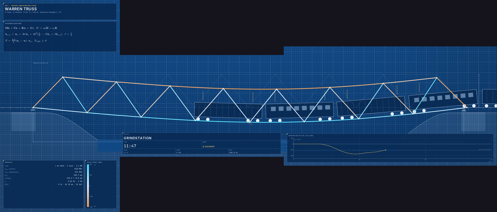
<sub>`bridge` on a portrait/laptop/landscape wall: one continuous structure, with equations, readouts and a live deflection plot around it.</sub>

Currents draws one continuous striped sheet across the wall. Its chrome
sphere sits on the front output, and the flow turns toward horizontal on
a wide layout so its swirling wake travels onto the neighbouring screen.


<sub>`splitflap` gives each screen a different board of the same station, all flipping together.</sub>


<sub>`gauges` puts the main cluster in the middle and extra instruments either side.</sub>

### Resolution

Under `--layer` every native saver draws at its output's full pixel
resolution: on a 3840x2400 panel at sway `scale 2` (or a fractional scale
like 1.3), it asks for the output's preferred scale (`wp_fractional_scale_v1`)
and draws a buffer that big, mapped onto the logical area with
`wp_viewporter` (`common/hidpi.h`). Layouts, text and line weights are kept
at their logical size, so a HiDPI screen looks the same, only sharper.
Compositors without those protocols get the logical size, as before.

A saver too heavy for a host's GPU can draw a fraction of that. Put
`SAVER FACTOR` lines (`* FACTOR` for the rest) in
`~/.config/wallpapers/render-scale` and `lock-bg.sh` passes them as
`--render-scale`; no file means full resolution everywhere. Benchmark first,
e.g. `./contours/contours --bench 90 --size 3840x2400`. The heavy 3D savers
(flightsim, orrery, clockwork, clocktower, aquarium) choose their own scene
resolution from a frame budget, so they rarely need an entry.

## The savers

### In the rotation

| | |
|---|---|
|  | **stir**: away messages ("Will is away from this computer…") and live details on a grid of letters, twisted like Midjourney's home page, on an old monitor with phosphor trails and a clock that fades in. Palettes: brass, paper, phosphor, amber, ice. `--text FILE` uses your own messages. |
|  | **nightsky**: the real sky for your place and time over a mountain lake: stars, Milky Way, Moon phase, planets, meteors, twilight. Constellation figures are drawn in dim gold and named like an old star atlas, with the planets and brightest stars labelled in italic; the names come out once it's dark and stay clear of the mountains. `--no-lines` and `--no-labels` turn them off. |
|  | **flightsim**: flying low over procedural mountains, forests and reflective lakes with a head-up display. Smooth HDR skies in day, golden-hour, dusk and night lighting; spans a wall as one camera. |
|  | **soapfilm**: physically computed thin-film colour: a draining film in a wire frame that turns black and bursts, alternating with drifting bubbles that merge and pop. A separate scene on each monitor; coarsening foam is opt-in with `--scene foam`. |
|  | **atc**: an air-traffic radar scope, a paper flight-strip board and an approach view. Real ADS-B from a local receiver or, if a location is set, adsb.lol; otherwise simulated traffic. Airships (the Goodyear blimps) get special attention. |
|  | **pendulums**: chaos made visible. A thousand double pendulums started a hair apart swing as one line, fray into a rainbow ribbon and bloom into chaos; also the flip-time chaos map and a Poincaré section building up. Live Lyapunov and energy-error readouts. |
|  | **voronoi**: Lloyd's relaxation: hundreds of Voronoi cells settle into a honeycomb, are stirred by ripples, swirls and wind, divide and fuse, and now and then bud into the time or the hostname. Stained glass, giraffe, crackle, blueprint, paper and honey. |
| 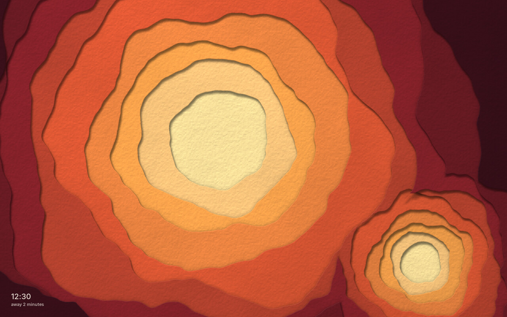 | **papercut**: a cut-paper shadow box: eight sheets of card over a base, each cut along a slowly changing line, every edge throwing a soft shadow that widens with the depth it falls. Nested tunnels, a drifting layered landscape, stacked topography and layered paper flowers, re-cut front sheets first every minute and a half; now and then a window is cut and the time or the host name rises through it in stepped outlines. On a wall, one continuous stack. Palettes: paper (white on white), dusk, sea, forest, kraft, ember, brass; `--scene` holds one. |
| 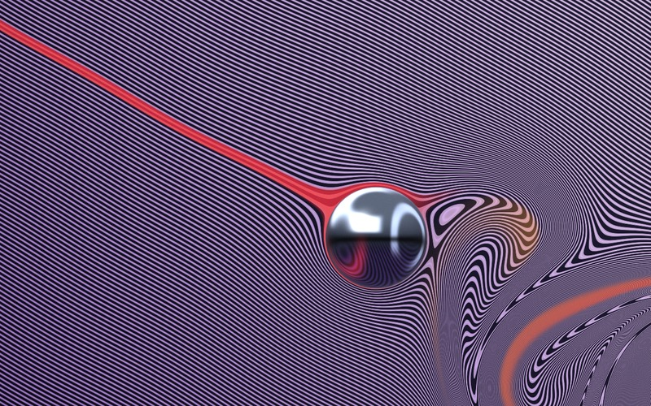 | **currents**: a chrome sphere in a violet striped flow, a scarlet ribbon streaming into it and an animated wake of alternating vortices. Inspired by Robert Beatty's artwork for [Tame Impala's *Currents*](https://portofsoundrecords.com/products/currents); drawn procedurally with no image assets. |
| 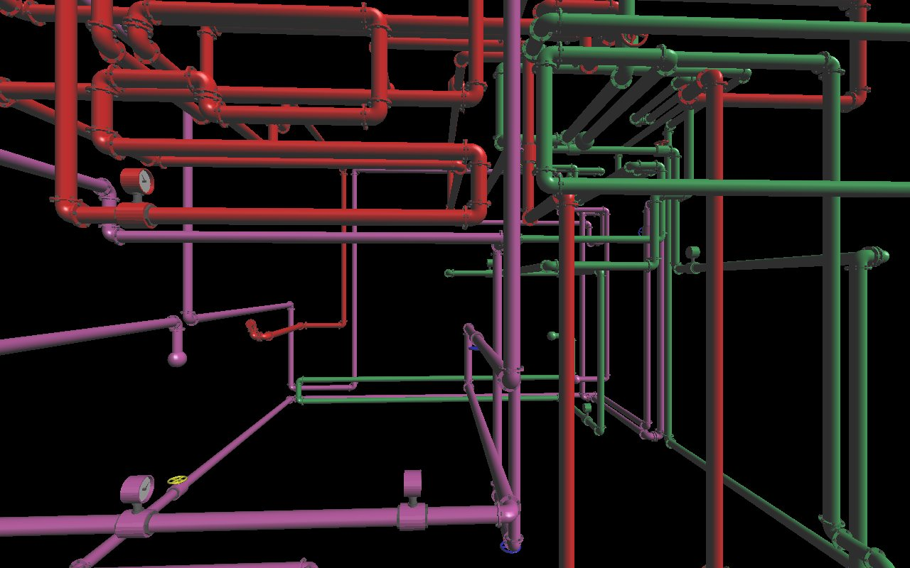 | **pipes**: xscreensaver's classic 3D pipes, growing until they fill the screen. Vendored as a binary from XScreenSaver 6.08. |
| 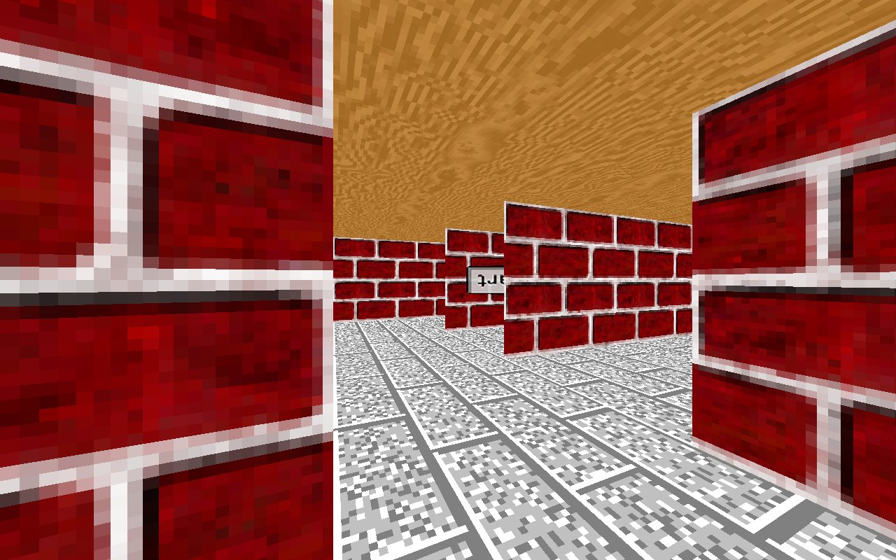 | **maze**: xscreensaver's Maze3D, a walk through a brick labyrinth. Vendored as a binary from XScreenSaver 6.08. |

**pipes** and **maze** run only on hosts that have built the Xwayland plumbing:
they draw on the root window of a private Xwayland, which `windowtolayer`
turns into a layer surface (see `lock-bg.sh`).

### Benched

These are built and work, but stay out of the rotation until they're promoted
in `savers.sh`.

| | |
|---|---|
|  | **gauges**: the machine's vital signs on a brass instrument panel: CPU temperature and load, a clock, memory, battery, and odometers for uptime and time away. |
|  | **aquarium**: a planted freshwater tank through the front glass: schooling neon tetras, angelfish, discus and corys with lofted bodies and rayed fins, a fire eel that burrows into the sand, cherry and Amano shrimp picking at the stones. Caustics, light shafts and real time-of-day lighting; a thermometer on the glass reads the CPU temperature. |
|  | **orrery**: a brass and enamel orrery in a dim study, planets where they really are tonight, its gear train turning in true ratios; now and then it winds forward months and back. |
| 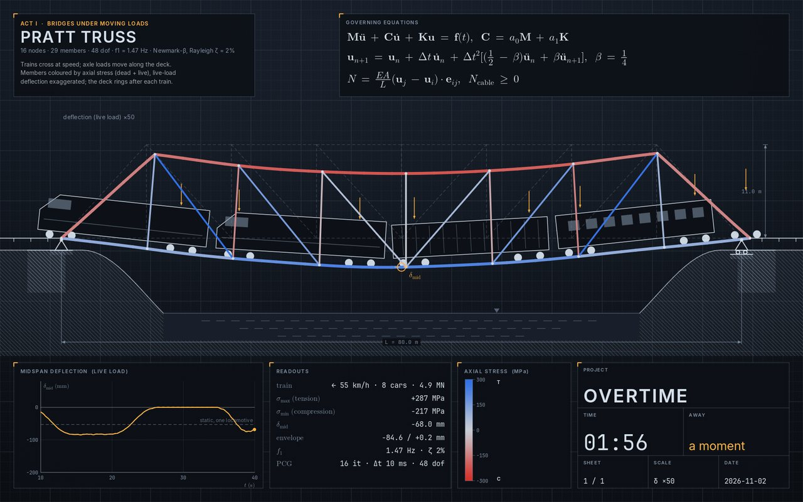 | **bridge**: a structural-analysis screen with the finite-element solver written from scratch: Warren, Pratt, arch, cable-stayed and suspension bridges with trains crossing (stress-coloured members, the deck ringing after), a plate with a hole against Kirsch, a cantilever and a bracket, and topology optimisation growing a truss out of grey. |
|  | **contours**: a drifting topographic map of terrain carved by its own drainage, with streams, villages, roads and invented place names. The sun moves and hills cast shadows. Palettes: brass, cream, slate, blueprint, survey. |
|  | **clockwork**: an opened-up clock movement ticking at the real time; on a wall the side screens show the escapement and the gear train. |
|  | **splitflap**: a railway departures board that clatters at each minute. Portrait screens get a tall platform board; a wall gets departures, arrivals and platform boards. Palettes: brass, classic, blue, led. |
|  | **lavalamp**: a lava lamp warming up from cold, its wax swelling, necking, pinching off, rising and sinking back; on a wall, one lamp per screen along a shared shelf. |
|  | **ink**: drops of ink falling into a tank of water and rolling into vortex rings and curling wisps, on a GPU fluid sim. Palettes: indigo, sumi, botanical, neon, sunset. |
|  | **marbling**: paper marbling made live: inks dropped, combed and raked into stone, chevron, nonpareil and bouquet patterns, then the sheet is lifted. |
|  | **billiards**: mathematical billiards. Ideal balls in circles, ellipses, stadia, cardioids and mushrooms trace glowing orbits next to their phase portraits: integrable, mixed and chaotic tables side by side. |
|  | **netflow**: the machine's own networking as a live stack diagram: packets flowing through interfaces, IP and TCP/UDP/ICMP to the sockets, per-interface scopes and connection-state dials. Aggregate counters from /proc only: no addresses, ports or captures. |
| 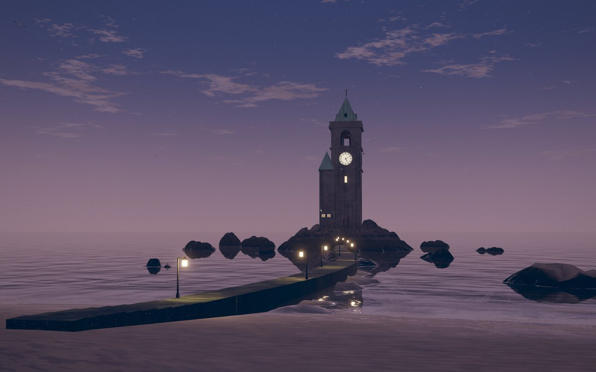 | **clocktower**: a lonely stone clock tower on a rock in the bay, its broken wall showing the movement and pendulum. The dials keep real time and the bell strikes the hours; the causeway floods and drains with a tide worked out from the real Moon and Sun; drums on the turret count the time away. |
| 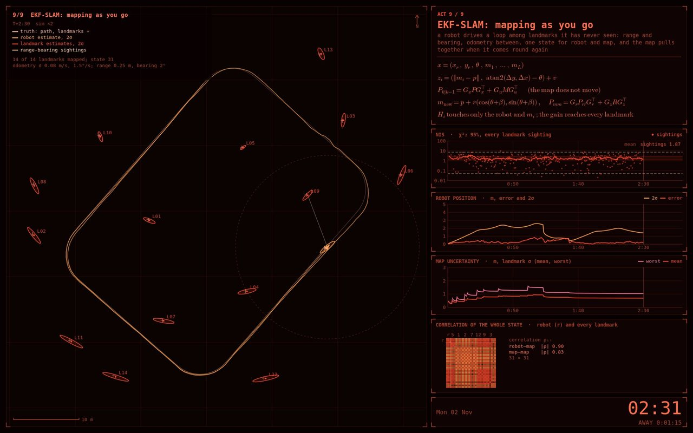 | **kalman**: state estimation in nine acts: Kalman, extended and unscented filters, an IMM tracker through manoeuvres, a particle filter on bearings only, multi-target tracking in clutter, an RTS smoother through GPS outages, sensor fusion in information form with covariance intersection, float32 square-root vs naive updates, and EKF-SLAM closing a loop. Typeset equations, χ² consistency charts and the filters' matrices as live heatmaps. |
| 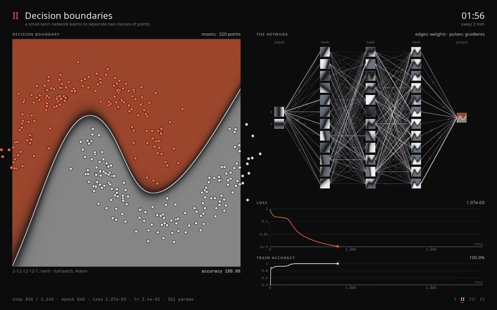 | **neural**: neural networks learning live, trained on the CPU with hand-written backprop: a SIREN painting a picture, a classifier finding its decision boundary, a character model learning to write away messages, and optimisers racing down a loss surface. |
| 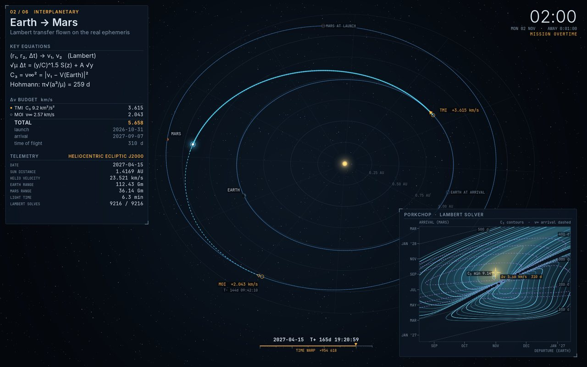 | **orbits**: a mission-control trajectory display: Hohmann and bi-elliptic transfers, Earth to Mars from today's real ephemeris with a live porkchop plot, a Jupiter flyby, the Earth–Moon three-body problem with its Lagrange points, a Walker constellation's ground tracks, and orbital decay. |
| 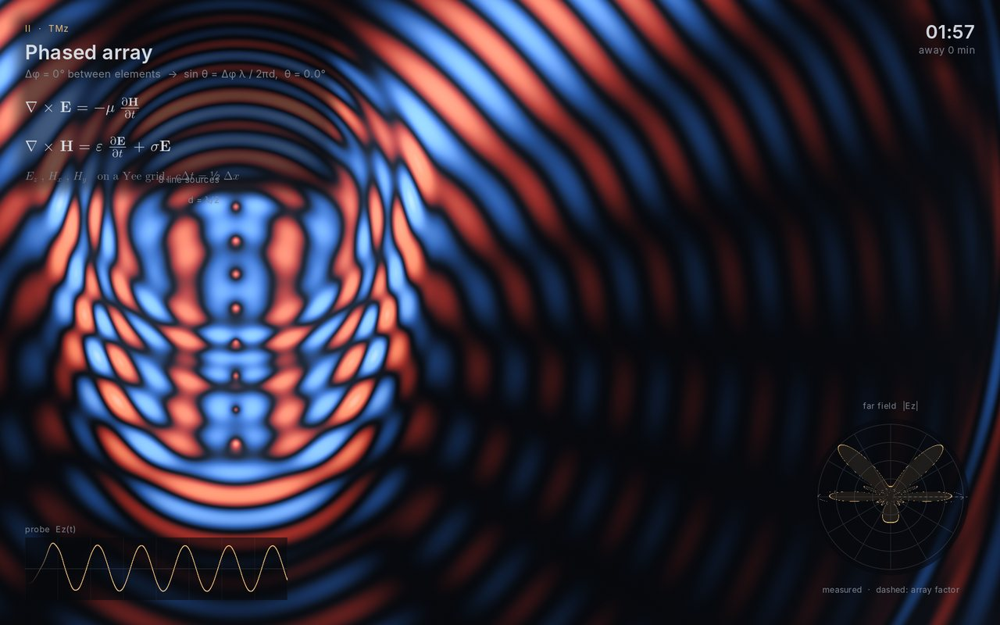 | **fdtd**: Maxwell's equations solved live on a GPU Yee grid with absorbing boundaries: dipoles, a steered phased array, a Yagi, a horn, a dish, lenses, a waveguide bend, a photonic crystal, slits, total internal reflection and a ringing cavity, with far-field polar plots measured from the field. |
| 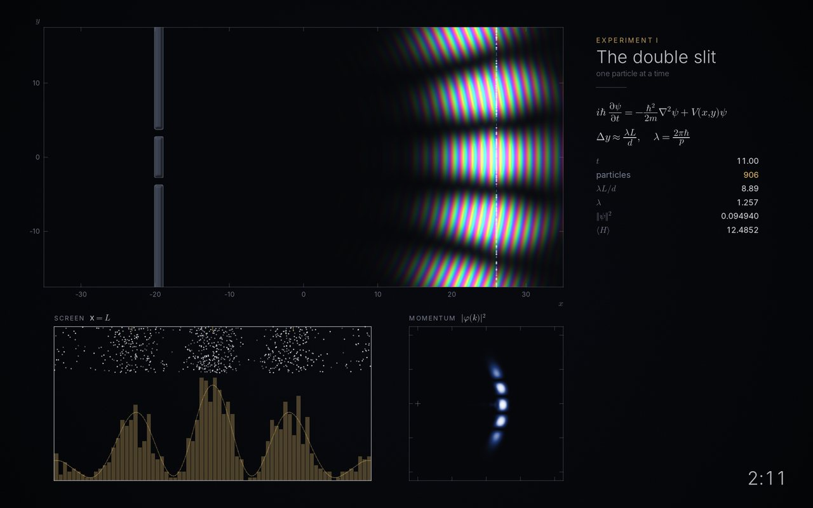 | **quantum**: the time-dependent Schrödinger equation solved live on the GPU (split-step Fourier): tunnelling through a barrier, the double slit building up particle by particle, coherent and squeezed states, revival in a box beside its quantum carpet, Bragg scattering off a crystal, and scars in a stadium. Hue is phase, brightness is probability. |
| 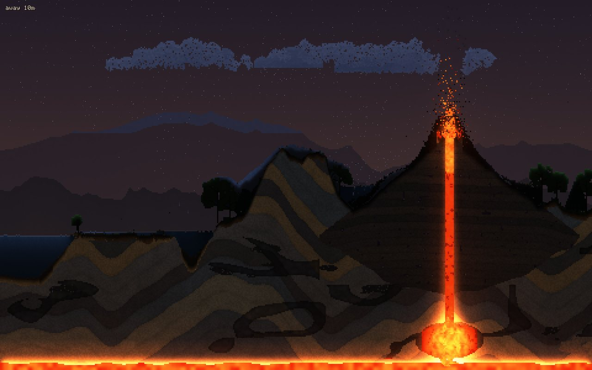 | **sand**: a falling-sand world that runs itself on the GPU: a side-on country of sea, forest, mountains and a volcano over folded strata, caves and a magma chamber. Water evaporates into clouds and rains back, lightning starts forest fires, the volcano erupts, lakes freeze in a 24-minute year; on a wall, one continuous world. |
| 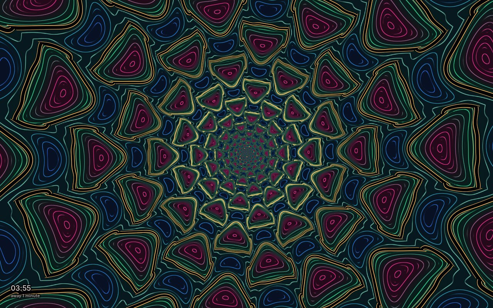 | **kluver**: Klüver's form constants, the tunnels, spirals, honeycomb lattices and cobwebs of psychedelic imagery, drawn as the cortex sees them: Turing-like planforms on the visual cortex carried back to the eye through the log-polar retinocortical map (Bressloff and Cowan's model), traced in fine isolines with a gold wire along one level. The field breathes, drifts and turns; over six minutes it comes up out of a marbled surface, peaks with the forms turning into one another, and melts back down. On a wall, one pattern around the front screen. Palettes: jewel, pastel, blacklight, oil; `--form` and `--phase` hold one. |
| 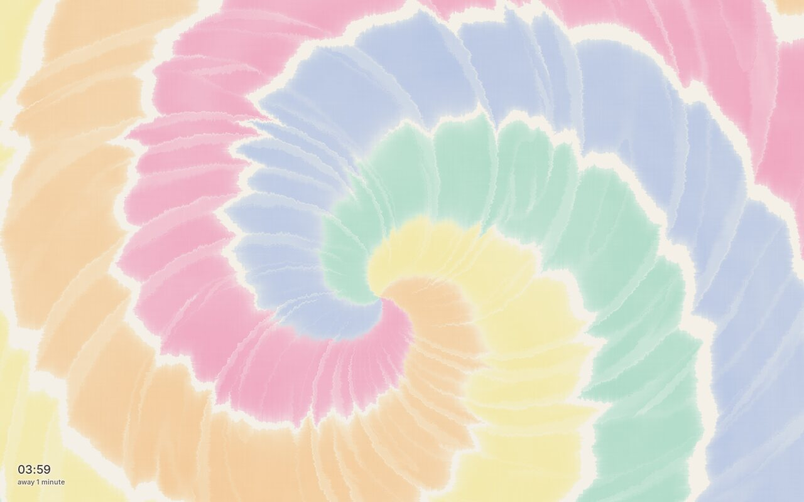 | **tiedye**: tie-dyed cotton made the way the real thing is: the cloth pinched and twisted flat for a spiral, or pulled up into a tube and bound with rubber bands for a bullseye, dye squirted on and wicking through the damp cotton on a GPU simulation, then opened out flat: sawtooth arms where the pleats doubled back, pale crease veins, feathered fibrous edges and subtractive mixing where colours meet. Each piece blooms in from a white cloth, wedge by wedge or band by band, dries, is held, and fades for the next. On a wall, one cloth. Palettes: pastel, rainbow, sunset, ocean, indigo; `--fold` and `--palette` hold one. |

## Building

Debian/Ubuntu packages:

```sh
sudo apt install build-essential pkg-config libgl-dev libegl-dev libx11-dev \
    libwayland-dev wayland-protocols libfontconfig-dev libfreetype-dev
```

From the repository root:

```sh
make -j4             # build all native C savers, including benched ones
make papercut         # or build just one
make active          # build native savers in the lock-screen rotation
make benched         # build native savers on the bench
make clean-papercut   # remove one saver's binary and generated protocols
make clean           # remove them for every native saver
make check           # Python tests
make help            # list build commands
```

The root Makefile delegates to each saver's Makefile, so unchanged binaries
are reused and `make -C papercut` still works. Compiler overrides are forwarded
(for example, `make papercut CC=clang`). Building a benched saver keeps it
benched; rotation membership comes from `savers.sh`. The vendored `pipes`
and `maze` binaries and optional tools under `build/` are managed separately.

`make check` needs Python 3. Render tests need an X display; Currents also
needs a built `currents` binary and Pillow, and Flightsim needs its generated
protocol files (`make -C flightsim`) and the C/GL build dependencies above.
They skip when their prerequisites are unavailable. On a headless host, run
`make currents flightsim`, then `xvfb-run -a make check` with Xvfb and Pillow
installed. Flightsim's GPU checks cover temporal blending, camera jitter,
flight through resolution changes, water-surface depth and deep valley mist.
They also check a stationary world stays still through the sampling cycle,
camera movement between simulation ticks, stable clouds across coordinate
wraps, and both HUD readouts on portrait displays.
Cloud quality and flicker during small camera movements are checked against
a dense reference render to catch under-sampling bands.

`flightsim/protocols/` holds the wlr-layer-shell protocol XML that every
saver's Makefile turns into Wayland glue.

## Running one by hand

Every saver has the same interface:

```sh
./stir/run.sh                       # fullscreen window (fullscreens itself under sway)
./stir/stir --window                # plain X11 window
./stir/stir --layer                 # wlr-layer-shell surface (what the lock screen uses)
./stir/stir --shot out.ppm --size 1920x1200 --at 30   # render one frame offscreen
./voronoi/voronoi --bench 300 --size 1920x1080        # time 300 frames offscreen (most savers)
./stir/stir --layer --render-scale 0.75               # draw 3/4 of the native pixels
```

Common options: `--seed N`, `--palette NAME` (where there are palettes),
`--epoch UNIXTIME --layout 'x,y,w,h;...' --output N` (spanning). Run any
saver with `--help` for its own options.

Flightsim uses `--time day|golden|dusk|night|random` for lighting. `--no-hud`,
`--no-trees` and `--no-clouds` hide individual layers; `--scale 0.75` fixes
the scene resolution instead of adapting it to the frame budget. On a wall,
the HUD stays on the centre monitor and fits its width, including in portrait.
The camera interpolates between the autopilot's fixed simulation ticks.
Sky clouds use ray steps no more than 24 metres apart, including near the
horizon, and share the scene's final smoothing pass. The last ray segment is
shortened rather than redistributing samples as the visible interval changes.
To reproduce its README screenshot:

```sh
./flightsim/flightsim --shot flightsim.ppm --size 1280x800 --seed 42 --time day --at 30
```

To try the multi-monitor behaviour on one screen, render each output's slice
offscreen and paste them together:

```sh
L='0,0,1440,2560;1440,560,1969,1231;3409,560,2560,1440'
./nightsky/nightsky --shot o0.ppm --size 1440x2560 --layout "$L" --output 0 --epoch 1790000000
./nightsky/nightsky --shot o1.ppm --size 1969x1231 --layout "$L" --output 1 --epoch 1790000000
./nightsky/nightsky --shot o2.ppm --size 2560x1440 --layout "$L" --output 2 --epoch 1790000000
```

## Location, network and privacy

- **Location:** `nightsky` and `atc` read an optional `~/.config/wallpapers/location`
  containing `LAT LON` (north and east positive), or take `--lat/--lon`.
  Without it, nightsky uses Greenwich and atc simulates traffic.
- **Automatic location (opt-in):** run `python3 location.py auto` to enable
  approximate public-IP geolocation for lock backgrounds (`nightsky`, `atc`,
  and `clocktower`). Run `python3 location.py manual` to disable it, or
  `python3 location.py status` to check the mode without making a request.
  The default is manual. Your saved `~/.config/wallpapers/location` is never
  overwritten and remains the fallback if detection fails. Standalone saver
  binaries still use their manual file or explicit `--lat/--lon` flags.
  Automatic mode contacts [ipapi.co](https://ipapi.co/api/) over HTTPS, exposing
  your public IP to that service; it sends no saved address or coordinates.
  This is an approximate area, not GPS, and a VPN may locate its exit server.
  Successful results are cached for an hour; failures are retried after five
  minutes. Requests time out after three seconds and concurrent outputs share
  a nonblocking cache lock. While another output fetches, a saver uses its
  manual fallback. Cache lives under `~/.cache/wallpapers/` and config under
  `~/.config/wallpapers/` (both respect XDG directory overrides).
- **Network:** `atc` uses the network when a location is
  set. It polls `api.adsb.lol` every 15 s with the coordinates rounded to two
  decimals, plus a check for the Goodyear airships every 5 minutes. It shares
  one cached fetch between all outputs and backs off on errors. A local
  readsb/dump1090 receiver on `127.0.0.1` is used in preference and keeps
  everything on the machine. `--sim` forces offline.
- **On screen:** the hostname, user name, times and aggregate machine
  statistics. Nothing else about the machine or the person.

## Adding a saver

1. Create `NAME/` with `NAME.c`, a `Makefile`, `run.sh` and a `.gitignore`
   for the binary and the generated `proto-*` files. Copy the plumbing
   (window, layer surface, `--shot`, `--bench`, layout) from an existing
   saver such as `gauges/`, including `common/hidpi.h` for native
   resolution (include `../common/hidpi.mk` at the end of the Makefile).
   The root Makefile discovers it automatically.
2. Add `NAME` to `BENCHED` in `savers.sh` (and to `SPANNING` if it takes
   `--epoch/--layout/--output`), and to the `pkill` pattern in `lock-next.sh`.
3. When it's ready, move it from `BENCHED` to `SAVERS`.
